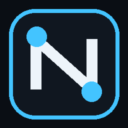
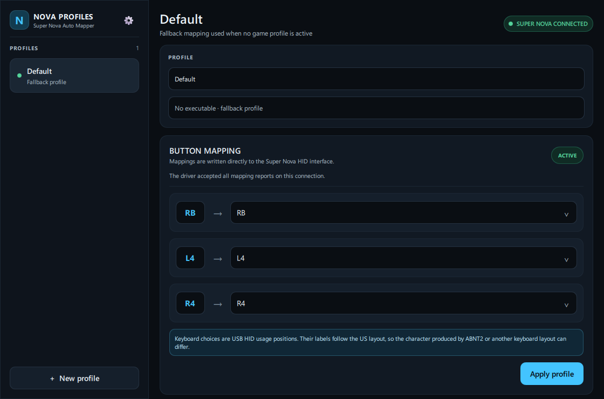

  

# NovaProfiles

Gerenciador de perfis de remapeamento para o controle **GameSir Super Nova** no Windows. O NovaProfiles associa perfis a jogos, detecta o executável em execução e aplica mapeamentos de RB, L4 e R4 diretamente pela interface HID do dongle.

> **Estado do projeto:** software comunitário e experimental, sem vínculo com a GameSir. A validação automatizada não substitui o teste em hardware real.

## O que ele faz

- cria, renomeia, duplica, importa e exporta perfis;
- associa um perfil ao caminho completo de um executável;
- alterna automaticamente ao abrir ou fechar um jogo;
- informa quando uma edição ainda não foi gravada no controle;
- reaplica o perfil esperado após reconexão do dongle;
- oferece catálogo de destinos de teclado USB HID e destinos seguros do controle;
- inicia com o Windows, minimiza para a bandeja e pode restaurar o perfil padrão ao sair;
- mantém dados do usuário, backups de importação e logs fora da pasta do programa;
- oferece interface em português do Brasil e inglês, conforme o idioma do Windows.

## Compatibilidade

| Item | Suporte validado/alvo |
|---|---|
| Sistema | Windows 10 ou 11 x64 |
| Execução pelo código-fonte | CPython 3.11 a 3.14 x64 |
| Controle | GameSir Super Nova |
| Conexão | Dongle 2,4 GHz, modo XInput |
| Interface esperada | VID `3537`, PID `103E`, coleção vendor-defined MI_01/COL04 |

Bluetooth, cabo USB, outros firmwares, outros modelos GameSir e múltiplos controles simultâneos não devem ser considerados compatíveis até passarem pelo checklist de hardware.

## Aviso importante sobre HID

O aplicativo envia relatórios de configuração diretamente ao controle. Uma interrupção, firmware incompatível ou dois configuradores escrevendo ao mesmo tempo podem produzir estado inesperado.

Antes de aplicar um perfil:

1. feche o GameSir Connect;
2. pare o serviço antigo `GameSirAutoProfile`, se ele existir;
3. conecte apenas o controle que deseja configurar;
4. exporte seus perfis antes de uma atualização importante;
5. não desconecte o dongle durante a gravação.

O NovaProfiles bloqueia a gravação quando o estado do serviço antigo é desconhecido ou ativo. Mesmo assim, use por sua conta e risco e mantenha uma forma oficial de restaurar a configuração do controle.

## Instalação

### Versão portátil

Baixe o arquivo `NovaProfiles-<versão>-win-x64.zip` na página de [Releases](https://github.com/VitorManuel01/NovaProfiles/releases), valide o SHA-256 publicado ao lado dele, extraia a pasta inteira e abra `NovaProfiles.exe`.

O projeto ainda não exige nem fornece certificado de assinatura de código. Por isso, o Windows SmartScreen pode exibir um aviso mesmo quando o checksum está correto. Não baixe executáveis fora deste repositório.

### Pelo código-fonte

1. Instale CPython x64 em uma das versões suportadas.
2. Clone ou baixe este repositório.
3. Execute `INSTALAR.cmd`.
4. Execute `EXECUTAR.cmd`.

O instalador cria `.venv`, instala versões exatas do lock Windows x64 e compila as traduções. Ele não faz uma atualização livre do `pip`.

## Uso rápido

1. Selecione um perfil ou crie um novo.
2. Em **Game executable**, escolha o `.exe` do jogo.
3. Selecione os destinos de RB, L4 e R4.
4. Clique em **Apply profile** para gravar agora.
5. Ative **Automatic profile switching** para alternar pelo processo em execução.

O selo **Active** indica que o driver aceitou toda a sequência de relatórios deste perfil nesta conexão; ele não representa leitura de volta do firmware. Após editar um mapeamento ativo, a interface mostra alterações pendentes até uma nova aplicação bem-sucedida.

## Teclado ABNT2 e USB HID

Os valores de teclado representam **usages USB HID**, isto é, posições/códigos enviados ao sistema, e não necessariamente o caractere impresso na tecla. Letras, números e controles comuns costumam coincidir entre layouts. Pontuação e teclas ISO, como as usadas no ABNT2, podem ser interpretadas de forma diferente pelo Windows ou pelo jogo.

Confira o rótulo do layout selecionado, teste primeiro em um aplicativo sem dados importantes e evite assumir que `[`/`]`, `/`, `;` ou acentos produzirão o mesmo caractere em US e ABNT2.

## Dados e privacidade

Perfis, configurações e logs ficam no diretório de dados escolhido pelo Qt para o usuário atual. Use **Settings → Open data folder** para abrir o local exato. O NovaProfiles não requer conta e não envia telemetria. Caminhos de jogos e nomes de processos podem aparecer nos arquivos locais; revise os logs antes de compartilhá-los em uma issue.

## Solução de problemas

| Sintoma | O que verificar |
|---|---|
| Controle desconectado | Use dongle 2,4 GHz + XInput; reconecte e feche o GameSir Connect. |
| Apply desabilitado | O serviço antigo pode estar ativo/desconhecido ou o dongle não foi encontrado. |
| Falha durante a gravação | O estado pode ter ficado parcial; reconecte o controle e reaplique o perfil desejado ou **Default**. |
| Perfil não troca | Confirme o caminho completo do `.exe` e se o auto-switch está ativo. |
| Mapeamento não corresponde ao caractere | Confira o layout USB HID/ABNT2 e o layout configurado no Windows/jogo. |
| Aplicativo não abre | Consulte `%TEMP%\NovaProfiles-startup-error.log`; ao executar pelo código-fonte, use também `EXECUTAR_DEBUG.cmd`. |
| Instalação falha | Confirme Windows x64, Python suportado e acesso ao PyPI. Não use Python da Microsoft Store se o launcher estiver inconsistente. |
| Serviço NSSM antigo | Execute `PARAR_SERVICO_NSSM_ANTIGO.cmd` como Administrador. O script apenas para; não remove o serviço. |

Ao relatar um problema, anexe a versão, edição do Windows, firmware, modo de conexão e as últimas linhas relevantes do log, removendo nomes de usuário e caminhos privados.

## Desenvolvimento e build

- [Como compilar](docs/BUILDING.md)
- [Arquitetura e invariantes](docs/ARCHITECTURE.md)
- [Checklist de hardware](docs/HARDWARE_TESTING.md)
- [Processo de release](docs/RELEASING.md)
- [Como contribuir](CONTRIBUTING.md)
- [Política de segurança](SECURITY.md)
- [Avisos de terceiros](THIRD_PARTY_NOTICES.md)
- [Histórico de mudanças](CHANGELOG.md)

O build oficial usa `NovaProfiles.spec`, `PySide6-Essentials`, UPX desativado, VersionInfo gerado de `version.py`, smoke seguro do executável, SBOM CycloneDX e checksum SHA-256.

## Licença

Ainda não há um arquivo `LICENSE` para o código do NovaProfiles. A escolha da licença pertence ao autor e permanece pendente; a publicação do repositório não deve ser interpretada como concessão automática de uma licença de uso, modificação ou redistribuição. As dependências mantêm suas próprias licenças, descritas em [THIRD_PARTY_NOTICES.md](THIRD_PARTY_NOTICES.md).
